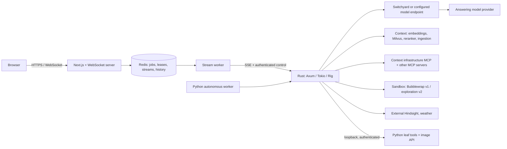

# Architecture and adaptation

Use this page to follow a chat request and find the code or configuration to
change. Prerequisite: a working [local chat setup](../README.md#local-setup).
For source changes, use the toolchains and checks in
[CONTRIBUTING.md](../CONTRIBUTING.md#development-and-checks).

## Request path

The browser connects to the Next.js application and its authenticated WebSocket
server. Redis owns queued jobs, streamed output, conversation history, and
approval records. The stream worker calls the Rust backend's
`POST /v1/chat/completions` endpoint.

1. The frontend authenticates a submission and reserves a per-user slot in Redis.
2. A stream worker claims the queued job and opens an SSE request to the backend.
3. The Rust loop calls the model and authorized tools. Python executes the leaf
   tools it still owns; the local clock runs entirely in Rust.
4. The worker persists output in Redis and publishes live events to the browser
   through WebSocket, with authenticated HTTP polling for recovery.

The chat activity indicator shows **Queued** until the backend accepts the
worker's request with successful streaming response headers. The worker then
persists and publishes the streaming status immediately, including while
backend preparation or model reasoning produces no visible output. This
transition reports execution progress; it does not imply the first answer
token has arrived. Backend selection runs at most three health probes at a
time per submission and cancels the remaining probes when a healthy pod responds.

Applications that speak OpenAI Chat Completions, OpenAI Responses, or Anthropic Messages
enter the same path through opt-in, API-key-authenticated `/v1` routes on the
frontend. They share step 1's submission service, limits and queue; see the
[compatibility API](compatibility-api.md).

The diagram includes optional integrations. The local configuration needs only
the browser, frontend, Redis, worker, backend, and model endpoint; Compose also
starts object storage. See [capability requirements](#capability-requirements)
for the rest.

The runtime rejects an enabled or malformed legacy `workflow.context_isolation`
setting at startup. Remove that retired setting from workflow configuration;
an explicit `enabled: false` remains accepted for existing deployments.

Redis makes chat admission, queue ownership, streamed output and finalization
recoverable. The model/tool execution itself lives in the backend process.
A worker that loses its lease aborts its request; reclaim never resubmits a
backend request that may have started (a start marker, streamed output, a
chat job's status past `pending`, or document-ingestion progress the backend
reported). It preserves completed output and reports
interruption, or the user's Stop, instead of risking duplicated external
actions. There is no durable checkpoint/resume of an in-flight Rust agent. See the
[long-running workflow guide](long-running-workflows.md) for scheduling,
context bounds and measurement commands.

Finalization saves the conversation, then records that save, releases the
conversation and chat slot, clears streaming state and publishes completion in
one Redis commit, so a guard is never released before the save is recorded.
The conversation write atomically verifies the finalizer's current lock token,
so a delayed owner whose lock expired cannot overwrite a later turn.
The same commit queues a completed turn for memory retention; the stream worker
sends it afterwards with bounded retries, and neither completion nor the next
turn waits for the memory service. Retention polling continues while all chat
execution slots are occupied, with at most one retention poll in progress.

The autonomous worker serves one configured account (`autonomousAgent.userId` in
the chart). It schedules independent calendar, game lighting, cluster maintenance,
and continual-improvement responsibilities in `autonomy:<user>:charter:*` Redis
state. It never consumes the retired research queue, feed or workspace notes.
A fenced transaction reserves each action before backend dispatch; unknown remote
outcomes are recorded for reconciliation. Game activations are not replayed.
The dashboard controls per-responsibility pause/interval settings and shows daily
summaries plus action evidence. See [autonomous charter operations](autonomy.md).

Autonomous requests carry the authenticated user identity, a task capability
boundary, a tool budget and `autonomy_output_schema`. The Rust runtime exposes
`submit_autonomous_result` for that run and validates the final arguments.
Completion must be submitted alone after the action's tools finish. For charter
tasks, the runtime also calls the authenticated Python
`/runtime/v1/autonomy/validate` endpoint before terminal publication. It uses the
worker's `CharterOutput` model, including date, source, evidence and identity
validators that JSON Schema cannot express. Rejected results enter the same
bounded argument-correction path without replaying research or mutations.
Validation service failures fail closed. Invalid prose cannot be published as a
result. The worker validates the result again before
committing observations, outcomes or future work. Existing user Google MCP grants
can be refreshed noninteractively; unavailable grants do not open consent flows.

Each authenticated user can submit up to five chats concurrently across tabs
and frontend instances. Redis atomically reserves a slot before enqueueing,
including pending jobs, and the owning worker renews that reservation while
running. Finalization and failed submission release it. The reservation stays
provisional for two minutes until the job's records are written, so a
submitting process that stops before queueing cannot hold a slot longer; the
next turn in that conversation also recovers it. A run awaiting OAuth
keeps its slot; if its stream ends first, the job ends with an error that keeps
its streamed output.
Separate conversations run independently; each conversation retains one active
response.
The Rust service also enforces five interactive runs per user within its process.
Scheduled autonomy runs, which carry the trusted `autonomy` execution scope, use a
separate per-user pool there, as they do not consume the frontend's chat slots;
the process-wide limit of 64 runs still applies. Each
stream worker has five execution slots by default. The production values run
two workers, giving both configured accounts capacity for five concurrent chats.
Redis admission applies across workers. The frontend displays the limit only
when a sixth submission is rejected.
Activity text, tool categories and accessibility announcements are scoped to
their conversation, so background runs cannot replace the selected chat's
indicator or clear it when another run completes.

## Cooperating repositories

The full stack separates four owners. The minimal local setup can use a model
provider directly and does not require all four services.

| Owner               | Responsibilities                                                                        | Agent boundary                                                            |
| ------------------- | --------------------------------------------------------------------------------------- | ------------------------------------------------------------------------- |
| Daedalus Agent      | Authentication, queue, agent loop, tool authorization, user scope, result publication   | Calls the configured model endpoint and service APIs                      |
| Daedalus Switchyard | Automatic classification, explicit aliases, provider transport and model streaming      | Model requests and continuations only                                     |
| Daedalus Sandbox    | Bubblewrap execution/offline checks; separate exploration v2 jobs and durable artifacts | Direct authenticated execution calls; agent publishes collected artifacts |
| Daedalus Context    | Curated ingestion, Milvus, embedding/reranking and infrastructure MCP services          | Direct retrieval, ingestion and MCP calls                                 |

Hindsight is an externally owned memory service integrated by context operations;
its implementation is not part of Daedalus Context. Agent-private document uploads
retain the agent's authenticated user scope and lifecycle even when they share
context's ingestion, embedding and storage services.

A curated search resolves a domain to a collection alias, embeds the query with
the query role, searches Milvus, optionally reranks, and returns passages and
source metadata to the agent. The next model round carries that tool result
through Switchyard. Sandbox results follow the same continuation boundary;
Switchyard does not execute tools or proxy context/sandbox service calls.

Keep the ingestion and query embedding model/revision, role templates, dimension,
normalization and truncation compatible. Equal dimensions alone do not establish
a shared vector space. The context stack's topology, RAG schema, collections and
environment contracts are the authority for service configuration. Its generated
agent environment supplies non-secret endpoints and readiness settings; merge
these into the selected agent deployment and provision credentials separately.
See [runtime configuration](operations.md#runtime-configuration) for precedence.

Reranker failures preserve the retrieved order, and so does a reranker that
cannot answer before the search deadline: the Rust retriever stops waiting
shortly before that deadline and returns the vector order. Curated results cite
an ingested source object by its `source_id`. Native retrieval uses `/rerank`
with raw logit scores; NIM-compatible clients use `/v1/ranking`. Do not interpret
these scores as probabilities or add a probability cutoff. Readiness, successful
ingestion submission, searchable content and a correct cited answer are separate
checks. A failed refresh can leave existing collections searchable while new
content remains unavailable.

## Code map

| Path                                                        | Responsibility                                                               |
| ----------------------------------------------------------- | ---------------------------------------------------------------------------- |
| [`frontend/`](../frontend/README.md)                        | Next.js UI and APIs, Redis job queue, stream worker, WebSocket sidecar       |
| [`builder/runtime/`](../builder/runtime/)                   | Rust agent loop, public backend APIs, native tools, provider and MCP clients |
| [`builder/daedalus_runtime/`](../builder/daedalus_runtime/) | Python tool service, supervisor, and remaining adapters                      |
| [`backend/`](../backend/)                                   | Workflow YAML; `local-chat-config.yaml` is the starting point                |
| [`protocol/`](../protocol/README.md)                        | Shared schemas and generated Rust, TypeScript, and Python types              |
| [`skills/`](../skills/AGENTS.md)                            | Agent instructions, loaded only when configured                              |
| [`helm/daedalus/`](../helm/daedalus/README.md)              | Kubernetes resources and values                                              |
| [`scripts/`](../scripts/), [`Makefile`](../Makefile)        | Validation, release, and development commands                                |

## Capability requirements

The home integration example is [tool-calling-config.yaml](../backend/tool-calling-config.yaml),
with environment settings in [.env.template](../.env.template). It includes
household-specific instructions, endpoints, and policies; select the parts you
need instead of switching your local setup to the entire file.

| Capability                               | Additional requirements                                                                                                                     |
| ---------------------------------------- | ------------------------------------------------------------------------------------------------------------------------------------------- |
| Image creation and analysis              | Configured image and vision providers                                                                                                       |
| Document ingestion and retrieval         | NV-Ingest, Milvus, compatible embeddings/reranking, and object-storage wiring                                                               |
| Durable agent memory                     | Hindsight service and credentials; enable the memory mode                                                                                   |
| GitHub, Google Workspace, or other tools | MCP endpoints, credentials or OAuth, and tool policies                                                                                      |
| Sandbox execution and generated files    | Compatible sandbox service, token, and artifact storage                                                                                     |
| Durable offline experiments and evidence | Exploration v2 service, grant-signing Secret, tool registration and artifact publication; see [sandbox exploration](sandbox-exploration.md) |
| Scheduled autonomous work                | Autonomous worker deployment, account identity, and non-interactive tools                                                                   |
| Tracing                                  | Phoenix or another configured tracing exporter                                                                                              |

Compose does not start these external integrations or the autonomous worker.
Credentials and reachable endpoints alone do not register tools: the workflow
must expose them. Runtime skills provide instructions, not new permissions.

## Where to change things

See [research workflows](research-workflows.md) for recoverable article output
and configuration-aware evaluation, including promotion criteria.

| Behavior                                                                 | Entry points                                                                                                                     |
| ------------------------------------------------------------------------ | -------------------------------------------------------------------------------------------------------------------------------- |
| Model/tool rounds, steering, retries and call binding                    | `builder/runtime/src/agent.rs`, `control.rs`, `provider.rs`                                                                      |
| Configuration, model profiles, native tool ownership and inbound history | `builder/runtime/src/config.rs`, `preparation.rs`                                                                                |
| Public API ownership and run deadlines                                   | `builder/runtime/src/main.rs` and its route modules                                                                              |
| MCP discovery, sessions, OAuth and approvals                             | `builder/runtime/src/mcp.rs`, `oauth.rs`, `authorization.rs`                                                                     |
| Recoverable output previews and exact retrieval                          | `builder/runtime/src/output.rs`, `output_retriever.rs`                                                                           |
| Remaining Python leaf tools and fallback preparation                     | `builder/daedalus_runtime/tools.py`, `service.py` and each tool package                                                          |
| Chat submission, admission, queue leases and recovery                    | `frontend/server/chat/submission.ts`, `cancellation.ts`, `frontend/pages/api/chat/async.ts`, `streamQueue.ts`, `streamWorker.ts` |
| OpenAI/Anthropic compatible API and API keys                             | `frontend/server/compat/`, `frontend/pages/api/v1/`, `frontend/server/apiKeys.ts`                                                |
| SSE reading, status persistence and finalization                         | `frontend/server/chat/streamReader.ts`, `streamState.ts`, `finalization.ts`                                                      |
| Scheduled charter responsibilities and autonomous work                   | `builder/autonomous_agent/src/autonomous_agent/worker.py`, `backend_client.py`                                                   |
| Enabled capabilities and deployment                                      | `backend/tool-calling-config.yaml`, `backend/local-chat-config.yaml`, `helm/daedalus`, `deploy.sh`                               |

Add native Rust tools in preparation and dispatch, with shared schemas and
service/built-image contracts. Remaining Python tools use the explicit factory
list in `daedalus_runtime/tools.py`; importing a package does not automatically
grant it access. Grant exposure in workflow YAML and preserve authenticated
identity, approval policy and cancellation when adding an integration.

To add one integration to an already working installation:

1. Copy `backend/local-chat-config.yaml` to a private workflow file. Point
   `BACKEND_CONFIG_FILE` at it for Compose, or pass `--backend-config` to the
   Kubernetes deployment command. Keep the clock as a baseline check.
2. Add the service's configuration under `functions` or `function_groups`, using
   the corresponding block in the full example as a reference. Supply its
   credentials in your private environment or scoped Kubernetes Secret. Add
   only the intended function or group names to `workflow.tools`.
3. Configure the service itself and its network access. For Kubernetes, use the
   [chart's credential and network settings](../helm/daedalus/README.md).
4. Recreate the local backend or use the [deployment procedure](operations.md#deploy-to-kubernetes).
   Check readiness, repeat the clock request, then make one read-only request
   that actually uses the new integration. Readiness alone does not prove a
   model can select and use its tools.

For changes to a tool implementation or provider, also run the applicable
[built-image checks](../CONTRIBUTING.md#development-and-checks).

## Runtime and provider boundaries

`builder/runtime` uses Rig for OpenAI Responses or Chat Completions, Tokio for
concurrency, and Axum for HTTP. Its application-owned loop controls model calls,
bounded tool batches, steering, cancellation, and terminal events. It never
executes a partial model tool call. Each run has a bounded, authenticated inbox;
duplicate command IDs are idempotent, and conflicting reuse is rejected.

When a handler rejects an HTTP/1 request before consuming its body, the runtime
responds with `Connection: close`. It does not drain the rejected upload or retry
the request. Fully consumed requests retain connection reuse; HTTP/2 keeps its
independent stream framing without connection-specific response headers.

Rust also owns YAML configuration, model/profile selection, inbound history budgeting,
automatic Hindsight context, tool-output compaction/cache writes and run state.
Its native clock and MCP clients need no Python tool service. Rust also owns
Google OAuth, exact-call approvals and per-user sessions.
Shared protocol types are generated for Rust, TypeScript and Python. The
[runtime compatibility guide](rust-migration.md)
describes the compatibility fixtures, remaining Python ownership and rollback.

Responses streams from compatible gateways may omit envelope metadata. The
runtime supplies missing sequence numbers and an unknown timestamp, and reuses
message IDs previously observed at the same output index. Content, tool call
identities, output indices, and completion status still pass Rig's validation.

Transient model stream failures use the configured bounded retry budget,
including Switchyard's in-stream upstream transport errors. Recovery retains
completed tool results and any answer text already streamed, asks the model to
continue without repeating that text, and discards tool proposals from the
failed response. A tool only runs after the whole model response completes.
JSON stream decoding failures allow one recovery attempt for the entire run,
within the configured model retry budget. Validation remains strict and no
tool proposals from the rejected response execute. Rejected frames log only
fixed event/category labels and parser positions, without conversation content.
Invalid requests and explicit incomplete responses keep their failure status.
Repeated malformed responses and exhausted transport retries return explicit
errors while preserving completed output.

The stream worker always requests SSE. A request without `"stream": true`
receives one Chat Completions object when the run ends. Its `finish_reason` is
the streaming terminal reason, such as `mcp_approval_required`, and approval,
OAuth and applied-steering events are kept in order in `daedalus_events`.
A failed run returns HTTP 502 with the streamed error message. Use streaming
for interactive runs: a non-streaming caller sees an OAuth prompt only after
the run ends.

Hidden reasoning and tool-argument events send content-free SSE activity comments
at most once every 15 seconds. These keep the frontend's stream idle watchdog
from treating a working model as disconnected. A provider that stops emitting
events sends no comments, and model and whole-run deadlines still apply.

Each model request includes an opaque `user` value for provider prompt-cache
affinity. It is a SHA-256 digest scoped to the authenticated user and conversation,
stable across model rounds, retries, profile promotions, and later conversation
turns. If no conversation ID is supplied, the run ID supplies that scope. The
length-delimited hash excludes raw identities from the provider field and keeps
different users' conversations distinct. It is a routing hint, not an
authorization or cache-isolation boundary. Switchyard preserves this standard
field when translating Responses to Fireworks Chat Completions; its Fireworks
configuration must not override it with a shared static session-affinity header.

The Rust provider wire also sends this opaque identity in
`x-switchyard-session-id`, separate from the provider's cache hint. The header is
scoped to each run's wire, so a shared HTTP client cannot mix users. It stays
stable across tool rounds and conversation follow-ups; a run without a
conversation gets its own identity. Current standalone Switchyard routes classify
every automatic request, including tool continuations, into max, high, low or
instant. Explicit aliases bypass classification. There is no retained effort
floor or sticky selection; fallback targets come from the selected provider's
`routes_*.toml`. Public effort aliases and provider-native reasoning settings are
separate contracts. Omit `model_profile` for automatic routing, and preserve
explicit selections among the profiles configured by the workflow.
Because a classified continuation can move the run to a provider that rejects the current
provider's retained reasoning state, the runtime never opens a user turn for
its own recovery guidance after tool results: argument corrections, disabled
tool notices, interrupted-stream and decode-retry instructions, evidence
checks, briefing synthesis prompts and the autonomy completion request ride
inside the last tool result. Steering, which is a real user direction, is
added as a user message. So is the instruction to continue an interrupted
answer whose partial text was already shown, because that text, not a tool
result, ends the transcript.

See [runtime logs](operations.md#runtime-logs) to correlate model attempts,
tool calls, and terminal events with a frontend job.

## Tool ownership and control

`builder/daedalus_runtime` runs Python tools on loopback port 8001. The Rust
process is the public backend on port 8000. The supervisor starts both, waits
for Python startup, forwards termination signals, and exits if either fails.
Rust owns memory and profile-import APIs, document/collection APIs and ingestion,
as well as the registered memory, output retrieval, document search/ingestion,
domain retrieval, NVIDIA documentation, Perplexity, skills, sandbox and weather
tools. It talks directly to their configured services.
Python runs RSS, generic scraping, source verification, briefing rendering and
visual media, and serves the image API and remaining public adapters behind the
Rust proxy. The briefing renderer calls its configured sandbox through the
Python `llm_sandbox` adapter, so the Python sandbox client stays in use even
though model sandbox calls are native Rust. The [ownership table](rust-migration.md#current-ownership) and
`main.rs` route registrations identify the boundary.
Internal tool endpoints require the shared internal credential and are blocked
at the public Rust proxy. The block applies to the path actually forwarded, after
percent-decoding and dot-segment removal. Tool identities come from authenticated
request context, never model arguments.

`sandbox_exploration_tool` is a native Rust tool with a Python compatibility
adapter sharing the same JSON schema. It sends short-lived owner/conversation
grants to the separate OpenShell exploration service. Sessions, asynchronous
runs, file checkpoints and evidence live there; publication reuses the frontend
artifact path after integrity checks. The legacy `llm_sandbox_tool` retains its
Bubblewrap contract. See [sandbox exploration](sandbox-exploration.md) for
configuration, limits and recovery semantics.

For Rust-prepared runs, Python supplies a catalogue and executes leaf calls with
an explicit versioned context; it does not own a second agent run. The full
image still requires that service. The separate `rust-minimal` image starts the
binary directly with the native clock, MCP and authorization enabled and omits
Python entirely. The autonomous worker remains Python and calls the same Rust
chat endpoint; a complete Python rewrite is not a release requirement.

When `parallel_tool_calls` is enabled, the runtime admits up to eight tool calls
at once. Stateful calls sharing a native tool type or MCP group remain serial.
The shipped workflow allows four independent scrapes and two source-verifier
calls. Each Python tool instance applies its own semaphore across runs, covering
robots checks and article retrieval for scrapes. These stateless results never
replace run-scoped executor snapshots. Results remain bound to their call IDs
even when completion order differs. Stop cancels active call transports. A public
article fetch already shared with other waiters can finish within its bounded
timeout to populate the cache.

Large MCP groups initially expose a capability description and a `__connect`
tool. Connecting adds the original authorized tool schemas for the rest of the
run. Hue also exposes selected common operations immediately. The shipped
configuration defers ESPN, X, GitHub, Kubernetes and UniFi catalogues, avoiding
sending unrelated schemas on every model round. Discovery retains existing
allowlists, per-user sessions and exact-call approval policies.

Steering uses `steer_job` over the existing WebSocket connection. The server
revalidates the login and stored job owner, then forwards a UUID command to
`POST /v1/runs/{run_id}/control`. During model generation, steering closes that
generation and discards incomplete tool calls. During tool execution, it keeps
started calls and their results, skips calls still queued, and adds the user's
direction before the next model round. A direction cannot undo a remote change
that has already started. Stop uses the existing job cancellation path.

No NeMo Agent Toolkit distribution, plugin discovery, workflow builder, runner,
or monkeypatch is installed. Existing `nat_helpers` package names, frontend
`natBaseUrl` fields, and OAuth Redis key prefixes remain data compatibility
names. Python leaf tools still use LangChain model clients where needed; the
agent loop does not use LangChain or LangGraph.

Google refresh grants remain at their existing per-user Redis keys. The
reader accepts legacy and versioned stored formats and writes versioned grants without
losing refresh tokens. Model or user instructions cannot bypass approval:
the MCP gate binds a one-use credential to the user, server, operation, and
canonical arguments. A scheduled autonomy run has no user watching it, so the
gate, in Rust and in the Python fallback, refuses an operation that would need
approval instead of recording an approval nobody can answer. The refusal is an
unexecuted-call error, and the run continues with its other work. If a run
still ends at an approval boundary, the worker records it as a failed run with
an `approval_blocked` event.
Uncertain remote mutations are never automatically retried.

The shipped Kubernetes MCP group uses `approval_policy: auto_approve` for its
explicit `include` list, including writes, pod commands and Helm operations.
Those calls stay in the normal model/tool loop: the agent receives each result,
can inspect and remediate further, verifies the outcome and returns an answer.
It does not enter the standalone exact-call approval flow described below.
This is deployment authorization, not a conversation-scoped approval grant;
it also applies to background runs. Task instructions restrict diagnostics to
reads and repairs to their requested scope. Server authentication, RBAC,
schema validation, exposure filters and execution limits remain enforced.
Unlisted tools and other integrations retain their configured approval policy.
Operators can restore exact approvals for the entire group or individual tools
with `approval_policy: approval_required` on the group or a `tool_overrides`
entry. Such overrides use the standalone flow and end the current agent run.
The Kubernetes skill requires explicit approval before compatibility-breaking
network changes and verification from actual client paths.

Approving an MCP request executes its exact stored call. Successful execution
returns the tool output through owner-authenticated status endpoints, and the
frontend replaces the approval prompt with that result in the saved conversation.
Status polling retries result delivery without executing the operation again.
Follow-up submissions and job finalization preserve the saved result even when
a browser or an earlier job still holds the approval prompt. Reopened approvals
can recover their conversation after the original chat job expires, using the
authenticated owner and matching request marker.

## Optional telemetry

Optional Phoenix export records content-free run counters and tool phase spans.
It omits prompts, tool arguments, results, identities, and credentials. The run
records how many responses actually reported usage so missing usage is not
mistaken for a measured zero. Steering and completion remain independent of
telemetry availability.
Cleanup accepts unknown token totals and omits them from spans, so partial
usage reports cannot prevent release of a failed or cancelled run.
Routing attributes are retained as the current selection and written once at
termination, alongside the outcome and counters. Repeated tool calls therefore
cannot exhaust the span attribute limit and discard terminal metrics.
The `telemetry_started` lifecycle log records the Phoenix `trace_id` inside the
existing run context, allowing exact trace-to-run correlation without exporting
user or conversation identifiers.
