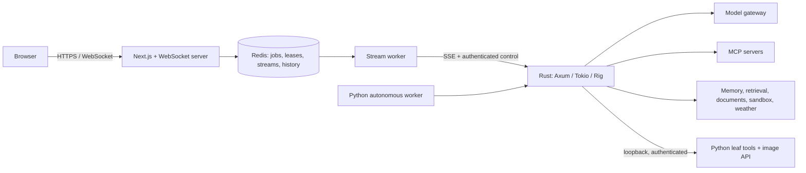

# Runtime architecture

The browser connects to the Next.js application and its authenticated WebSocket
server. Redis owns queued jobs, streamed output, conversation history, and
approval records. The stream worker calls the Rust backend's
`POST /v1/chat/completions` endpoint.



Redis makes chat admission, queue ownership, streamed output and finalization
recoverable. The model/tool execution itself lives in the backend process.
A worker that loses its lease aborts its request; reclaim never resubmits a
backend request already marked as started. It preserves completed output and
reports interruption instead of risking duplicated external actions. There is
no durable checkpoint/resume of an in-flight Rust agent. See the
[long-running workflow review](long-running-workflows.md) for measurements,
current bounds and the next optimization candidates.

Each authenticated user can submit up to five chats concurrently across tabs
and frontend instances. Redis atomically reserves a slot before enqueueing,
including pending jobs, and the owning worker renews that reservation while
running. Finalization, OAuth handoff and failed submission release it. Separate
conversations run independently; each conversation retains one active response.
The Rust service also enforces five runs per user within its process. Each
stream worker has five execution slots by default. The production values run
two workers, giving both configured accounts capacity for five concurrent chats.
Redis admission applies across workers. The frontend displays the limit only
when a sixth submission is rejected.
Activity text, tool categories and accessibility announcements are scoped to
their conversation, so background runs cannot replace the selected chat's
indicator or clear it when another run completes.

`builder/runtime` uses Rig for OpenAI Responses or Chat Completions, Tokio for
concurrency, and Axum for HTTP. Its application-owned loop controls model calls,
bounded tool batches, steering, cancellation, and terminal events. It never
executes a partial model tool call. Each run has a bounded, authenticated inbox;
duplicate command IDs are idempotent, and conflicting reuse is rejected.

Rust also owns YAML configuration, model/profile selection, inbound history budgeting,
automatic Hindsight context, tool-output compaction/cache writes and run state.
Its native clock and MCP clients need no Python tool service. Rust also owns
Google OAuth, exact-call approvals, execution receipts and per-user sessions.
Shared protocol types are generated for Rust, TypeScript and Python. The
[migration record](rust-migration.md)
describes the compatibility fixtures, remaining Python ownership and rollback.

Responses streams from compatible gateways may omit envelope metadata. The
runtime supplies missing sequence numbers and an unknown timestamp, and reuses
message IDs previously observed at the same output index. Content, tool call
identities, output indices, and completion status still pass Rig's validation.

Transient model stream failures use the configured bounded retry budget,
including Switchyard's in-stream upstream transport errors. Recovery retains
completed tool results and any answer text already streamed, asks the model to
continue without repeating that text, and discards tool proposals from the
failed response. A tool only runs after the whole model response completes.
JSON stream decoding failures allow one recovery attempt for the entire run,
within the configured model retry budget. Validation remains strict and no
tool proposals from the rejected response execute. Rejected frames log only
fixed event/category labels and parser positions, without conversation content.
Invalid requests and explicit incomplete responses keep their failure status.
Repeated malformed responses and exhausted transport retries return explicit
errors while preserving completed output.

Hidden reasoning and tool-argument events send content-free SSE activity comments
at most once every 15 seconds. These keep the frontend's stream idle watchdog
from treating a working model as disconnected. A provider that stops emitting
events sends no comments, and model and whole-run deadlines still apply.

Each model request includes an opaque `user` value for provider prompt-cache
affinity. It is a SHA-256 digest scoped to the authenticated user and conversation,
stable across model rounds, retries, profile promotions, and later conversation
turns. If no conversation ID is supplied, the run ID supplies that scope. The
length-delimited hash excludes raw identities from the provider field and keeps
different users' conversations distinct. It is a routing hint, not an
authorization or cache-isolation boundary. Switchyard preserves this standard
field when translating Responses to Fireworks Chat Completions; its Fireworks
configuration must not override it with a shared static session-affinity header.

The Rust provider wire also sends this opaque identity in
`x-switchyard-session-id`, keeping Composite routing state separate from the
provider's cache hint. The header is scoped to each run's wire, so a shared HTTP
client cannot mix users. It stays stable across tool rounds and conversation
follow-ups; a run without a conversation gets its own identity. Switchyard judges
new user turns for the automatic profile and reuses that tier during tool
continuations. Explicit profiles bypass the judge. Gateway state is in memory;
missing state after restart defaults to the capable tier in our patched build.

Backend application logs are JSON lines on stdout. They record run start/end,
preparation, model attempts and retries, time to the first model event, tool
execution, steering, cancellation, approval waits, and process lifecycle. A final
run summary includes elapsed time, model/tool call counts, and reported token
usage. Failures include their stage, category, and HTTP status when available.
Prompts, answers, tool arguments/results, user identities, credentials, raw
provider errors, and OAuth URLs are excluded from these application logs.

`LOG_LEVEL=INFO` is the default for both processes; `DEBUG` also logs MCP
discovery timings, and `WARN`/`ERROR` reduce progress output. Rust additionally
honors `RUST_LOG` when set. Use `daedalus_runtime=debug` to scope Rust diagnostics
to application events. Uvicorn and other dependencies retain their own log
formats. No Phoenix collector is needed to see application logs.

Follow the backend with:

```bash
kubectl -n daedalus logs -f deployment/daedalus-backend-default -c backend
```

The Rust `span.run_id` and Python `fields.run_id` identify the same frontend job.
To inspect one run, filtering out non-JSON server messages:

```bash
kubectl -n daedalus logs deployment/daedalus-backend-default -c backend --since=30m |
  jq -R 'fromjson? | select((.span.run_id // .fields.run_id) == "RUN_ID")'
```

`builder/daedalus_runtime` runs Python tools on loopback port 8001. The Rust
process is the public backend on port 8000. The supervisor starts both, waits
for Python startup, forwards termination signals, and exits if either fails.
Rust owns memory and profile-import APIs, document/collection APIs and ingestion,
as well as the registered memory, output retrieval, document search/ingestion,
domain retrieval, NVIDIA documentation, Perplexity, user interaction, skills,
sandbox and weather tools. It talks directly to their configured services.
Python runs RSS, generic scraping, source verification, briefing rendering and
visual media, and serves the image API and remaining public adapters behind the
Rust proxy. The [ownership table](rust-migration.md#current-ownership) and
`main.rs` route registrations identify the boundary.
Internal tool endpoints require the shared internal credential and are blocked
at the public Rust proxy. Tool identities come from authenticated request
context, never model arguments.

For Rust-prepared runs, Python supplies a catalogue and executes leaf calls with
an explicit versioned context; it does not own a second agent run. The full
image still requires that service. The separate `rust-minimal` image starts the
binary directly with the native clock, MCP and authorization enabled and omits
Python entirely. The autonomous worker remains Python and calls the same Rust
chat endpoint; a complete Python rewrite is not a release requirement.

When `parallel_tool_calls` is enabled, the runtime admits up to eight tool calls
at once. Stateful calls sharing a native tool type or MCP group remain serial.
The shipped workflow allows four independent scrapes and two source-verifier
calls. Each Python tool instance applies its own semaphore across runs, covering
robots checks and article retrieval for scrapes. These stateless results never
replace run-scoped executor snapshots. Results remain bound to their call IDs
even when completion order differs. Stop cancels active call transports. A public
article fetch already shared with other waiters can finish within its bounded
timeout to populate the cache.

Large MCP groups initially expose a capability description and a `__connect`
tool. Connecting adds the original authorized tool schemas for the rest of the
run. Hue also exposes selected common operations immediately. The shipped
configuration defers ESPN, X, GitHub, Kubernetes and UniFi catalogues, avoiding
sending unrelated schemas on every model round. Discovery retains existing
allowlists, per-user sessions and exact-call approval policies.

Steering uses `steer_job` over the existing WebSocket connection. The server
revalidates the login and stored job owner, then forwards a UUID command to
`POST /v1/runs/{run_id}/control`. During model generation, steering closes that
generation and discards incomplete tool calls. During tool execution, it keeps
started calls and their results, skips calls still queued, and adds the user's
direction before the next model round. A direction cannot undo a remote change
that has already started. Stop uses the existing job cancellation path.

No NeMo Agent Toolkit distribution, plugin discovery, workflow builder, runner,
or monkeypatch is installed. Existing `nat_helpers` package names, frontend
`natBaseUrl` fields, and OAuth Redis key prefixes remain data compatibility
names. Python leaf tools still use LangChain model clients where needed; the
agent loop does not use LangChain or LangGraph.

Google refresh grants remain at their existing per-user Redis keys. The new
reader accepts the previous stored format and writes versioned grants without
losing refresh tokens. Model or user instructions cannot bypass approval:
the MCP gate binds a one-use credential to the user, server, operation, and
canonical arguments. Uncertain remote mutations are never automatically retried.

Optional Phoenix export records content-free run counters and tool phase spans.
It omits prompts, tool arguments, results, identities, and credentials. The run
records how many responses actually reported usage so missing usage is not
mistaken for a measured zero. Steering and completion remain independent of
telemetry availability.
Routing attributes are retained as the current selection and written once at
termination, alongside the outcome and counters. Repeated tool calls therefore
cannot exhaust the span attribute limit and discard terminal metrics.
The `telemetry_started` lifecycle log records the Phoenix `trace_id` inside the
existing run context, allowing exact trace-to-run correlation without exporting
user or conversation identifiers.

## Where to change things

| Behavior                                                                 | Entry points                                                                                       |
| ------------------------------------------------------------------------ | -------------------------------------------------------------------------------------------------- |
| Model/tool rounds, steering, retries and call binding                    | `builder/runtime/src/agent.rs`, `control.rs`, `provider.rs`                                        |
| Configuration, model profiles, native tool ownership and inbound history | `builder/runtime/src/config.rs`, `preparation.rs`                                                  |
| Public API ownership and run deadlines                                   | `builder/runtime/src/main.rs` and its route modules                                                |
| MCP discovery, sessions, OAuth and approvals                             | `builder/runtime/src/mcp.rs`, `oauth.rs`, `authorization.rs`                                       |
| Recoverable output previews and exact retrieval                          | `builder/runtime/src/output.rs`, `output_retriever.rs`                                             |
| Remaining Python leaf tools and fallback preparation                     | `builder/daedalus_runtime/tools.py`, `service.py` and each tool package                            |
| Chat submission, admission, queue leases and recovery                    | `frontend/server/jobSubmission.ts`, `frontend/server/chat/streamQueue.ts`, `streamWorker.ts`       |
| SSE reading, status persistence and finalization                         | `frontend/server/chat/streamReader.ts`, `streamState.ts`, `finalization.ts`                        |
| Scheduled goals and autonomous work                                      | `builder/autonomous_agent/src/autonomous_agent/worker.py`, `backend_client.py`                     |
| Enabled capabilities and deployment                                      | `backend/tool-calling-config.yaml`, `backend/local-chat-config.yaml`, `helm/daedalus`, `deploy.sh` |

Add native Rust tools in preparation and dispatch, with shared schemas and
service/built-image contracts. Remaining Python tools use the explicit factory
list in `daedalus_runtime/tools.py`; importing a package does not automatically
grant it access. Grant exposure in workflow YAML and preserve authenticated
identity, approval policy and cancellation when adding an integration.
