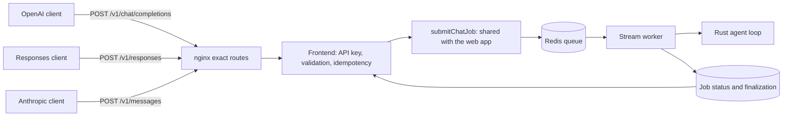

# OpenAI and Anthropic compatible API

Daedalus can serve applications that speak the OpenAI Chat Completions, OpenAI
Responses, or Anthropic Messages API. The `daedalus` model runs the full Daedalus agent as the API key's
owner: the same Rust agent loop, authorized server-side tools, memory,
retrieval, skills and connected services as the web application, through the
same queue, per-user limits, conversation locks and finalization.

The optional `daedalus-model` alias forwards OpenAI requests directly to the
configured model provider, returning caller-defined tool calls and preserving
structured-output controls, token limits, and inline history. It does not run
the agent or execute tools. See [Direct model requests](#direct-model-requests).

For the `daedalus` agent, the endpoints accept the vendors’ create-request schemas and return their JSON
and SSE response shapes. Provider-specific controls are advisory: they are
accepted, dropped, and reported in `X-Daedalus-Ignored-Parameters`. This is
wire-format compatibility with the Daedalus agent, not vendor feature parity.
Clients that require a particular ignored feature must account for that limit.

## How a request runs



1. The frontend authenticates the API key, validates the request against the
   matrix below, and checks the shared per-user submission rate limit. Invalid
   requests fail before a job exists.
2. `frontend/server/chat/submission.ts` admits the run exactly as a browser
   submission: the user's five-chat slot, the conversation guard, the
   `[IDENTITY]` message, backend selection and the queue commit. API runs ask
   the backend for `response_mode: final_only`.
3. A stream worker runs it against the Rust `/v1/chat/completions` endpoint.
   Tool calls stay inside Daedalus; clients never receive tool calls to execute.
4. The adapter reads the finalized job status and encodes the final answer, or
   an error, in the caller's protocol.

| Area                             | Entry points                                                                                                                      |
| -------------------------------- | --------------------------------------------------------------------------------------------------------------------------------- |
| Routes                           | `frontend/pages/api/v1/chat/completions.ts`, `responses.ts`, `messages.ts`, `models.ts` (public paths are rewritten from `/v1/*`) |
| Validation                       | `frontend/server/compat/openaiRequest.ts`, `responsesRequest.ts`, `anthropicRequest.ts`, `content.ts`, `request.ts`               |
| Execution, idempotency, encoding | `frontend/server/compat/execution.ts`, `idempotency.ts`, `runObserver.ts`, `responders.ts`                                        |
| Keys                             | `frontend/server/apiKeys.ts`, `frontend/pages/api/api-keys/`, `frontend/components/connections/ApiKeysPanel.tsx`                  |
| Shared services                  | `frontend/server/chat/submission.ts`, `cancellation.ts`, `finalization.ts`                                                        |
| Run usage                        | `builder/runtime/src/events.rs` (`usage` event), `frontend/server/chat/streamReader.ts`                                           |
| Routing                          | `helm/daedalus/templates/config-nginx.yaml`, `compatibilityApi` in `helm/daedalus/values.yaml`                                    |

## Enable and roll back

The API is off by default. `compatibilityApi.enabled: true` in the chart:

- adds exact nginx routes for `POST /v1/chat/completions`, `POST /v1/responses`,
  `POST /v1/messages` and `GET /v1/models` to the frontend. Every other `/v1` path stays blocked by
  restricted mode, which the chart requires for this setting;
- sets `DAEDALUS_COMPAT_API_ENABLED=true` on the frontend. Without it, the
  handlers answer 404 even when reached directly;
- optionally sets `DAEDALUS_PUBLIC_URL` from `compatibilityApi.publicUrl`, the
  browser origin used in approval, connection and generated-file links.
  Without it, links use the request's forwarded host and scheme.

```yaml
compatibilityApi:
  enabled: true
  publicUrl: https://daedalus.example
```

Before enabling, inventory existing `/v1` consumers: in unrestricted mode nginx
sends `/v1/` to the backend, so the chart refuses to combine that mode with
these routes. Existing NodePorts, the WebSocket service and backend service
connections are unchanged.

To roll back, set `compatibilityApi.enabled: false` and upgrade the release.
The routes disappear and the handlers return 404. The web application, its
chat history and existing integrations do not depend on them. API keys stay
stored and work again if the API is re-enabled; revoke them to retire them.

Verify an enabled deployment from a LAN client that is not a cluster node:

```bash
curl -sS https://daedalus.example/v1/models \
  -H "Authorization: Bearer $DAEDALUS_API_KEY"
curl -sS https://daedalus.example/v1/chat/completions \
  -H "Authorization: Bearer $DAEDALUS_API_KEY" -H 'Content-Type: application/json' \
  -d '{"model":"daedalus","messages":[{"role":"user","content":"What time is it?"}]}'
```

Then confirm that a chat, an approval and the Connections page still work in
the browser.

## API keys

Signed-in users create, list, rotate and revoke their own keys under
**Connections → API access**. A key is shown once. Only a SHA-256 verifier of
its 256-bit secret is stored. Each user can hold ten keys. A key acts only for
its owner and stops working when it is revoked or rotated, or when that account
is removed from the configured users. Rotation replaces the secret and keeps
the name in one atomic step.

The session API behind the page is `GET`/`POST /api/api-keys` and
`DELETE /api/api-keys/{id}` or `POST /api/api-keys/{id}` with
`{"action":"rotate"}`. It accepts only browser sessions.

Send the key as `Authorization: Bearer <key>` or `x-api-key: <key>`. Both
headers work on every route; two different keys in one request are rejected.
Browser session cookies are not accepted on the compatibility routes. Caller
attempts to send backend identity, execution scope, approval or internal
credentials are ignored by the frontend and removed by nginx.

## Client configuration

| Client         | Base URL                      | Model      |
| -------------- | ----------------------------- | ---------- |
| OpenAI SDKs    | `https://daedalus.example/v1` | `daedalus` |
| Anthropic SDKs | `https://daedalus.example`    | `daedalus` |

```python
from openai import OpenAI

client = OpenAI(base_url="https://daedalus.example/v1", api_key=KEY,
                timeout=2400, max_retries=2)
stream = client.chat.completions.create(
    model="daedalus", stream=True,
    messages=[{"role": "user", "content": "Summarize my calendar for today."}],
    extra_headers={"Idempotency-Key": "calendar-2026-11-06"},
)
```

The same OpenAI client can use Responses:

```python
response = client.responses.create(model="daedalus", input="What time is it?")
print(response.output_text)
```

```python
from anthropic import Anthropic

client = Anthropic(base_url="https://daedalus.example", api_key=KEY)
with client.messages.stream(model="daedalus", max_tokens=2048, messages=[
        {"role": "user", "content": "What changed in my documents this week?"}]) as stream:
    print(stream.get_final_text())
```

Tested clients are the official OpenAI and Anthropic SDKs at the versions
pinned in `frontend/package.json` (`openai` 7.43.0, `@anthropic-ai/sdk` 1.3.0).
Other applications are not claimed as supported until tested.

## Compatibility matrix

### Direct model requests

Use `model: "daedalus-model"` on `/v1/chat/completions` or `/v1/responses`
when your client needs to execute its own tools or requires structured output
and provider-enforced token limits. Authentication uses the same per-user API
key. Existing `daedalus` requests keep the full agent behavior described below.

```yaml
compatibilityApi:
  enabled: true
  modelEndpoint:
    enabled: true
    model: '' # Empty uses llms[workflow.llm_name].model_name.
```

The Helm chart enables this alias with the compatibility API by default;
`modelEndpoint.enabled: false` disables only direct inference. For local runs,
set `DAEDALUS_COMPAT_API_ENABLED=true` on the frontend and
`DAEDALUS_COMPAT_MODEL_ENABLED=true` on both frontend and Rust backend.
`DAEDALUS_COMPAT_MODEL_NAME` is an optional backend-only model override. The
provider URL and credential come from the workflow's configured LLM and remain
in the backend. Rust preparation is required. No ports or ingress paths change.

The configured provider must implement **both** OpenAI create endpoints and
support the selected model's requested controls. The adapter forwards the
request without converting protocols, rewriting history, or estimating output
tokens. In particular, it retains:

- Chat Completions `tools`, `tool_choice`, `parallel_tool_calls`,
  `response_format`, `max_completion_tokens`, and legacy `max_tokens`;
- Responses `tools`, `tool_choice`, `parallel_tool_calls`, `text.format`, and
  `max_output_tokens`;
- inline system/developer instructions, assistant tool calls, tool-result IDs,
  tool outputs, and all supplied history facts.

Provider JSON and SSE bodies pass through unchanged, including tool calls,
structured text, usage, refusals, and token-limit termination. The response's
`model` identifies the upstream model. There is no agent fallback or local
text truncation. Provider rejection is returned as an error; provider diagnostic
bodies are sanitized. An upstream `X-Daedalus-Ignored-Parameters` header causes
an error rather than a successful response with discarded controls. A provider
that silently violates its contract still requires provider-side remediation;
forwarding alone cannot guarantee model compliance.

```python
response = client.responses.create(
    model="daedalus-model",
    input="Record the verified identifier A-17.",
    tools=[{
        "type": "function", "name": "record_fact", "strict": True,
        "parameters": {
            "type": "object", "properties": {"fact": {"type": "string"}},
            "required": ["fact"], "additionalProperties": False,
        },
    }],
    tool_choice={"type": "function", "name": "record_fact"},
    max_output_tokens=128,
)
```

The client executes returned function calls and resends their outputs with the
inline history. Direct requests do not read or modify saved Daedalus histories
or memories, and cannot execute Daedalus's internal tools. Verify a provider
with a named tool call, a strict JSON schema, and a small token budget for each
API before configuring clients to depend on it.

Direct inference is stateless: `store` is set to `false`; `store: true`,
`background: true`, provider resource references (`previous_response_id`,
`conversation`, `prompt`, file IDs and item references), hosted tools, `X-Daedalus-Conversation-ID`, and
`Idempotency-Key` are rejected explicitly. This prevents resolving another
user's provider resources through the shared service credential. Only function
tools executed by the caller are supported. Anthropic requests cannot select
this alias.

Direct inference shares the per-user request-start rate limit and has a separate
runtime capacity limit of five active requests per user and 64 per process.
Requests have a ten-minute provider deadline and cancel on client disconnect.
The agent's queue, approval flow, persistence, and idempotency rules below apply
to `daedalus`, not direct inference.

### Agent model

`GET /v1/models` advertises `daedalus` and, for OpenAI clients when enabled,
`daedalus-model`. A vendor model name in a create
request is accepted as an alias for the agent and reported as ignored; the
response identifies the actual model as `daedalus`. It uses automatic model
selection. Caller model names never select a provider or grant permissions.

All documented top-level create parameters are recognized. Text, caller
instructions, streaming, and final-answer budgets affect behavior. Other
parameters are accepted and reported in `X-Daedalus-Ignored-Parameters`.
Malformed core fields, unknown top-level fields, and oversized requests still
fail before execution. Histories are bounded to 500 input entries, 2 MiB of
retained text and 32 KiB of caller instructions; the HTTP body limit also
applies to data that will be dropped.

### OpenAI Chat Completions

`POST /v1/chat/completions` accepts `messages`, including system/developer
instructions, participant names, assistant refusals and tool history. Text
content is retained. Supplied tool/function results become untrusted user
conversation text; tool calls are never executed from the request. Non-text
parts (images, audio and files) and message metadata are accepted and dropped.
An assistant-ending history gets an explicit continuation turn for the agent.

`stream_options.include_usage` controls the usage chunk. `max_completion_tokens`
takes precedence over deprecated `max_tokens` when both are supplied, with
`max_tokens` reported as ignored. Other options—including `n`, stop sequences,
structured output, tool definitions/selection, audio, sampling, logprobs,
reasoning effort, prediction, storage, cache and service-tier controls—are
advisory. Daedalus returns one text answer, even when `n` requests more.

Responses are `chat.completion` objects with one assistant choice and
`finish_reason` `stop` or `length`. Streams use `chat.completion.chunk` objects,
an optional usage chunk and the final `[DONE]` marker.

### OpenAI Responses

`POST /v1/responses` accepts string `input` or an input-item array, plus optional
`instructions`. Message text (`input_text`, `output_text` and refusals),
system/developer messages, and inline function/custom-tool outputs are retained.
Tool outputs are untrusted conversation text. Other items, including reasoning,
compaction data, hosted tool calls and item references, are accepted and dropped.
`max_output_tokens` bounds the final answer and `stream` selects SSE delivery.

`previous_response_id`, `conversation`, `prompt`, `store`, `background`, hosted
tools, file/vector-store IDs, remote MCP definitions, multimodal content, and
all other provider controls are advisory. No vendor resource is retrieved or
modified. `background: true` still waits for the request-bound run. Resend text
history or use `X-Daedalus-Conversation-ID` for Daedalus conversation state.
Vendor database operations (stored-response/completion retrieval, listing,
updates, deletion and cancellation by vendor ID) are not exposed.

Responses have `object: response`, `resp_` IDs, an assistant output message
with `output_text` content, and `status: completed` or `incomplete`. Truncation
sets `incomplete_details.reason: max_output_tokens`. Streaming sends numbered
`response.created`, `response.in_progress`, output-item/content-part lifecycle
and text-delta events, then `response.completed` or `response.incomplete`.
Failures send `response.failed` and an `error` event. The official SDK's
`responses.create()` and `responses.stream().finalResponse()` expose
`output_text` from these messages.

### Anthropic Messages

`POST /v1/messages` accepts `messages`, string or text-block `system`, `stream`,
and required `max_tokens`. Text blocks and inline tool-result text are retained;
images, documents, thinking, tool-use blocks, citations and cache markers are
accepted and dropped. Tool definitions, tool choice, stop sequences, thinking
settings, output configuration, sampling, metadata, service tiers, containers,
MCP and other provider controls are advisory.

Responses are `message` objects (`msg_<run id>`) with one `text` block,
`stop_reason` `end_turn` or `max_tokens`, and `null` `stop_sequence`,
`stop_details`, `container` and `diagnostics`. Streams send `message_start`,
`ping` keepalives, one text content block, `message_delta` with the stop
reason and usage, then `message_stop`.

The version header is optional. The pinned SDK's current and legacy versions
are recognized; other date-shaped versions and beta/workspace/profile selectors
are accepted as advisory and never change identity or permissions. Sampling
fields from older clients remain advisory under newer version headers.
`max_tokens: 0` returns an empty message without running the agent or its tools;
it does not populate a vendor prompt cache.

For all three APIs, a request whose content is entirely dropped is accepted
with a synthetic turn asking for usable text. External references are never
resolved to reconstruct missing text.

### Headers

| Header                                            | Direction | Meaning                                                                                     |
| ------------------------------------------------- | --------- | ------------------------------------------------------------------------------------------- |
| `Idempotency-Key`                                 | Request   | 1–255 printable ASCII characters; see [Retries](#retries-and-idempotency)                   |
| `X-Daedalus-Conversation-ID`                      | Both      | Continue a saved conversation; returned when used                                           |
| `X-Daedalus-Run-ID`, `x-request-id`, `request-id` | Response  | The run's job ID, for correlation with logs and the web app                                 |
| `X-Daedalus-Ignored-Parameters`                   | Response  | Advisory parameters this request carried                                                    |
| `X-Daedalus-Usage`                                | Response  | Messages/Responses non-streaming usage completeness: `complete`, `partial` or `unavailable` |
| `X-Daedalus-Idempotent-Replay`                    | Response  | `true` when the response describes an earlier run                                           |
| `x-should-retry`                                  | Response  | Whether the official SDKs may retry this error                                              |

## Behavior

### Final answers and latency

API runs request final-only presentation. Text a model writes in rounds that
also call tools, and its reasoning, stay out of the answer. The answer is
released when the run is finalized, so time to the first answer token equals
the run's duration. Streaming responses start immediately and send keepalives
(OpenAI `: keepalive` comments, Anthropic `ping` events) every 15 seconds.
Generated-image and artifact links are app-relative in Daedalus and become
absolute links to this deployment. Opening them requires the same user's
browser session; no filesystem paths or internal hosts are returned.

### Output budget

`max_tokens`, `max_completion_tokens`, and `max_output_tokens` bound the returned answer only. The
agent's internal model and tool work has its own bounds: the workflow's
iteration limit and the 30-minute run deadline. Because one run may use
providers with different tokenizers, the answer is measured with one estimator,
one token per four UTF-8 bytes, and truncated at a character boundary with
`finish_reason: length`, `stop_reason: max_tokens`, or Responses
`status: incomplete`.

### Usage

Usage covers every agent model call in the run, including tool rounds. It does
not cover model calls made inside tools (such as image or vision tools), the
gateway's routing judge, or automatic memory retention. The Rust runtime
reports it in a content-free `usage` event before its terminal event.

- Chat Completions: `usage` and the streaming usage chunk appear only when every model
  call reported usage. They are omitted otherwise, never estimated.
  `prompt_tokens_details.cached_tokens` reports cache reads when known.
- Responses: `usage` is `null` unless all model calls reported totals. When
  present it contains `input_tokens`, `output_tokens`, `total_tokens`, and the
  required detail objects. Unmeasured cache-write/reasoning breakdowns use zero
  as a lower bound, not a claim of measured zero. Cache reads use measured
  values when available, otherwise the same zero lower bound.
- Anthropic: the schema requires numbers. When some call did not report
  usage, the values are the measured lower bounds from calls that did, and
  `X-Daedalus-Usage` says `partial` or `unavailable` on non-streaming
  responses. `input_tokens` excludes cache reads, which appear in
  `cache_read_input_tokens`. Cache creation is not measured and is `null`.

### Conversation state

Without `X-Daedalus-Conversation-ID`, the request's history is authoritative.
The run uses an isolated internal conversation identity that no other call
shares. It is not shown in the web app and is not sent to automatic memory
retention, so clients that resend full history do not create duplicate
memories. This makes the request stateless, not the tools: memory tools,
documents and integrations still read and change the user's data.

With `X-Daedalus-Conversation-ID`, the saved conversation is authoritative.
The ID must be one the user owns, or a new ID, which creates a conversation.
Another user's ID returns 404. Earlier turns come from the saved history; the
request contributes the user messages after its last assistant message, so
clients may resend full history or send only the new turn. Edits to earlier
turns are ignored. These turns use the web app's conversation lock (one active
response per conversation; a second gets 409 with `x-should-retry: true`),
appear in the web app, and follow the normal memory-retention policy. Caller
instructions apply to each request and are not saved.

Caller instructions (`system`, `developer`) are sent to the agent as a
message marked as subordinate to Daedalus policy and the authenticated
identity, placed directly before the final user turn. They cannot change
identity, grant tool access or approve actions.

The agent reads the most recent part of a long history: the workflow's inbound
budget (`max_history`, `max_history_tokens`, by default 50 messages and about
32,000 estimated tokens) selects messages from the end. Placing the
instructions next to the final turn keeps them inside that window.

### Approvals and OAuth

An API key never approves anything. Protected actions keep the existing
approval and OAuth requirements, and the API reports them as HTTP 403
(`permission_error`) with a `daedalus` extension in the error object:
`run_id`, `action_url`, `requirement` and, for approvals, `conversation_id`.
Streaming responses carry the same error as their in-stream error event.

- **Approval** (`requirement: mcp_approval`): the gated call was not
  executed and the run ends at the approval boundary, as it does in the web
  app. An isolated run is saved as a conversation so the prompt can be
  answered at `action_url` (`/?conversation=<id>`). Approving executes that
  exact call in the web app. To continue, send the next message with
  `X-Daedalus-Conversation-ID` set to `conversation_id`.
- **OAuth** (`requirement: oauth`): Google sign-in completes only inside the
  run that requested it, which an API caller cannot attend. The run is stopped
  and `action_url` opens Connections. Connect the service from a chat in the
  web app, then retry; saved authorization is reused by later API runs.

Neither case is reported as a completion or with an invented finish reason.

### Retries and idempotency

The official SDKs retry 408, 409, 429 and 5xx responses and timeouts unless
`x-should-retry` says otherwise. Daedalus sets it on every error:

- `true` only for failures that happened before a run could act: the shared
  rate limit, the five-active-run limit, a busy conversation and temporary
  admission failures. These include `Retry-After` where useful.
- `false` for validation and authentication errors and for anything after a
  run started, including failed, stopped and authorization-blocked runs and a
  queue commit whose outcome is unknown.

`Idempotency-Key` makes a repeated request safe for 24 hours. The key is
scoped to the account and route and bound, before queueing, to a hash of the
whole request body and conversation header. A repeat of the same request
attaches to the run while it is active, then replays its answer or error. A
different request with the same key returns 409. A key whose run could not be
confirmed as queued is never replayed; it returns 409 and the run ID to check
in the web app. Submissions rejected before queueing release the key. SDKs do
not send `Idempotency-Key` themselves; set it per request.

### Cancellation, timeouts and limits

Runs are bound to their request. A client that disconnects stops the run
through the web app's Stop path: completed output is kept, completed actions
are not undone, and the slot is released. There is no detached
background execution and no resume of an interrupted run.

The frontend waits up to 40 minutes for a run (the runtime's 30-minute run
deadline plus queueing) and nginx allows 45. Non-streaming responses send
nothing until the run ends, and the official SDKs time out after 10 minutes
by default. For long tasks, use streaming or raise the client timeout, and
send an `Idempotency-Key` so a timed-out retry reports the stopped run instead
of starting another.

API and browser submissions share each user's limits: five active runs, the
`RATE_LIMIT_CHAT` submission budget, and the backend's per-user pool. nginx
also limits request starts per IP (`compatibilityApi.rate`).

## Decision record

| Decision                     | Choice                                                                                                                      |
| ---------------------------- | --------------------------------------------------------------------------------------------------------------------------- |
| First supported applications | Official OpenAI and Anthropic SDKs at the pinned versions                                                                   |
| Version baseline             | `openai` 7.43.0 and `@anthropic-ai/sdk` 1.3.0; `anthropic-version` `2023-06-01` and `2026-10-21`                            |
| Caller instructions          | Subordinate model-input message before the final user turn; never persisted                                                 |
| Output budget                | Final answer only, estimated at four bytes per token; internal work keeps its own limits                                    |
| Usage                        | Whole-run agent model calls; OpenAI omits incomplete usage, Anthropic reports measured lower bounds with `X-Daedalus-Usage` |
| Authorization handoff        | 403 with a Daedalus link and run ID; approvals end the run and save a conversation, OAuth stops the run                     |
| Idempotency retention        | 24 hours                                                                                                                    |
| API conversation visibility  | Isolated calls are hidden and not retained to memory; `X-Daedalus-Conversation-ID` turns are normal conversations           |
| Key management               | Session-authenticated Connections page and API                                                                              |

## Operations

Every finished API run logs one content-free `compat_run_finished` event from
the frontend, with `protocol`, `runId`, `mode` (`new` or `attached`),
`stream`, `outcome` (`completed`, `approval_required`, `oauth_required`,
`failed`, `cancelled`, `client_disconnected`), `queuedMs`, `durationMs`,
`truncated`, `usage` completeness and token counts. Repeated keys log
`compat_idempotent_retry`. Prompts, answers, keys and tool payloads are not
logged. Correlate a run with the worker and runtime logs by its run ID, which
is also the job ID used in [runtime logs](operations.md#runtime-logs).

## Validation

| Check                                                   | Command                                                                         |
| ------------------------------------------------------- | ------------------------------------------------------------------------------- |
| Request contracts, encoders, orchestration              | `cd frontend && npx vitest run __tests__/server/compat`                         |
| Keys, idempotency and isolated runs against Redis       | `make test-integration`                                                         |
| Pinned SDKs through the real frontend, worker and Redis | `cd frontend && npm run e2e -- e2e/tests/compat-api.spec.ts --project=chromium` |
| Built backend image and its native clock tool           | `make candidate-browser`                                                        |
| Routes and rollback rendering                           | `make helm`, plus `helm template ... --set compatibilityApi.enabled=true`       |

## References

- [OpenAI Chat Completions streaming](https://developers.openai.com/api/reference/resources/chat/subresources/completions/streaming-events)
- [OpenAI Responses](https://developers.openai.com/api/reference/resources/responses)
- [Anthropic Messages](https://platform.claude.com/docs/en/api/messages) and [streaming](https://platform.claude.com/docs/en/build-with-claude/streaming)
- [Anthropic API versions](https://platform.claude.com/docs/en/api/versioning)
