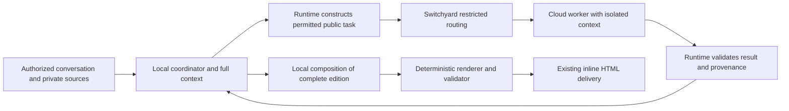

# Daedalus Context Isolation and Adaptive Model Routing

**Software Requirements Document — implementation proposal**  
**Version:** 1.0  
**Date:** 2026-10-26  
**Primary implementation owner:** Daedalus agent team  
**Integration dependency:** Switchyard routing and provider transport

## 1. Purpose

Enable Daedalus to use different levels of model capability within a daily-summary workflow while keeping private information inside the trusted local environment. The local model may access the complete context that the user and existing application permissions authorize. Cloud models receive separate, bounded tasks containing only information permitted for external processing.

The runtime must construct and enforce these context boundaries. Model instructions and profile names are insufficient to enforce them. Switchyard must preserve the runtime's destination restrictions through classification, generation, retries, and fallback.

The initial use case is the interactive `daily-summary` skill. The design should support other workflows without requiring their adoption in the first release.

## 2. Problem and current behavior

The daily-summary skill combines personal-source reads, public research, editorial judgment, structured edition composition, and deterministic HTML rendering. These operations have different capability and privacy requirements.

The current implementation creates several obstacles:

1. The agent builds model requests from a shared history using `request.chat_history = history.clone()` in `builder/runtime/src/agent.rs`. Changing the model carries earlier private messages and tool results to the new destination.
2. Switchyard's current classifier policy assigns non-sensitive daily summaries at least `xhigh` for the entire task. The named-target patch retains the selected task target even for efficient stage decisions. An initial `xhigh` choice therefore prevents routine steps from dropping to a cheaper target.
3. The Daedalus workflow maps daily-summary requests and skill loads to the `deep` profile. Its effective model alias must be reconciled with the new workflow policy; it must not silently override individual task routing.
4. The skill reads Gmail, Calendar, and potentially personal health memory early. A public-news step later in the same history can still contain private information.
5. Current Composite fallback can move a `local` selection to a cloud capable target. Local selection is currently a preference, not an enforced destination restriction.

Disabling session retention alone does not address these problems. The required change is to retain workflow state locally while constructing distinct model contexts for separately scoped work.

## 3. Scope and trust assumptions

### In scope

- A local coordinator with the complete authorized workflow context.
- Isolated tasks for public research and synthesis, with independently selected model profiles.
- Runtime enforcement of context contents, tool access, and external destinations.
- Switchyard enforcement of destination restrictions and compatible fallbacks.
- Daily-summary integration, observability, quality evaluation, and staged rollout.

### Out of scope

- Granting new Gmail, Calendar, memory, filesystem, or infrastructure permissions.
- Replacing existing OAuth, approval, read-only tool, or user-isolation controls.
- Changing LAN endpoints, fixed NodePorts, ingress routes, or service authentication as part of this feature.
- Replacing the canonical briefing renderer or changing the successful edition format.
- Guaranteeing savings or assigning final model profiles before evaluation.
- General-purpose autonomous multi-agent collaboration beyond bounded runtime-managed worker tasks.

### Trust assumptions

The basement-hosted local model and explicitly designated local application components are trusted to process all context authorized for the current user and workflow. This does not grant the model access to unrelated users, administrative credentials, or additional tools.

External model providers, public search services, and other outbound services are outside that processing boundary. An externally connected tool remains an outbound boundary even when called by the local model. An existing Gmail read is a separately authorized interaction with the user's mail service; authorization to read that mail does not authorize sending its contents to an unrelated model provider.

## 4. Required architecture



The local coordinator owns the task plan, personal-source processing, integration of public findings, and the final edition containing private material. It may propose public worker tasks. The runtime decides whether those tasks and their inputs are permitted to leave the local environment.

Each public worker has its own context and restricted tool surface. A cloud worker never inherits the coordinator's history. Its results return to the local coordinator as untrusted evidence with source provenance.

No new user confirmation is required for routine work already authorized by the user's request and established export policy. If a task cannot satisfy that policy, it remains local or returns a bounded failure; the runtime must not silently broaden the policy.

## 5. Functional requirements

### 5.1 Context classification and provenance

**CTX-01:** The runtime must distinguish at least `LOCAL_ONLY` and `EXTERNAL_ALLOWED` data. These are proposed internal names, not existing API fields. Data with unknown or missing classification must be treated as `LOCAL_ONLY` for outbound model requests.

**CTX-02:** The full coordinator context must remain local. Email, calendar details, personal memory, private documents, private tool results, and confidential user instructions must default to `LOCAL_ONLY`.

**CTX-03:** Model-generated material must inherit the restrictions of its inputs. A summary, plan, embedding, extracted fact, or tool argument derived from private data does not become externally permitted merely because a model rewrote it.

**CTX-04:** Every exportable context item must have runtime-maintained provenance: source identity, classification, scope, and the policy decision permitting export. Text supplied by a model or retrieved page cannot set or override these attributes.

**CTX-05:** The runtime must build external requests from an allowlist of permitted items. It must not copy the full history and rely on free-text redaction to remove sensitive passages.

**CTX-06:** Export policy must account for task descriptions and source selection as well as source text. A public article can be exportable while the explanation that it relates to the user's diagnosis remains private. Allowed transformations should use bounded templates or validated fields. Arbitrary text generated from mixed private context must remain local unless covered by an explicit release policy.

### 5.2 Isolated worker tasks

**TASK-01:** A worker task must declare its objective, phase, input references, expected output schema, tool allowlist, budget, and destination policy. The runtime must resolve input references against authorized storage; possession of an identifier alone is not sufficient authorization.

**TASK-02:** External task context must include only the necessary instructions and permitted evidence. It must exclude coordinator history, private memory, personal-source results, private profile instructions, credentials, unrelated attachments, and hidden state from previous requests.

**TASK-03:** Worker tools must be restricted to the task. Public workers must not receive Gmail, Calendar, private memory retrieval, unrestricted internal URL fetching, or another route back into coordinator state. Every worker tool call must pass runtime authorization and outbound argument checks before execution.

**TASK-04:** Workers must return structured findings with source identifiers, citations, freshness information where applicable, and explicit limitations. The runtime must validate structure and source references before incorporating results. Public output remains untrusted and cannot authorize actions or alter routing policy.

**TASK-05:** Each worker must have a separate session and cache namespace scoped to the authenticated user, run, task, and context policy. Provider conversation IDs and previous-response references must never reconnect a public task to private context. Identifiers sent externally must not expose raw user or conversation identity.

**TASK-06:** A worker's own permitted context may be retained across its tool rounds. Changing its allowed context or destination policy must invalidate incompatible session state. The coordinator's full session remains separate throughout.

### 5.3 Model selection and destination enforcement

**ROUTE-01:** Privacy eligibility must be resolved before capability selection. A `LOCAL_ONLY` request must be limited to configured trusted local destinations. The destination registry must identify actual provider endpoints and their trust designation; a target named `local` is not sufficient evidence of locality.

**ROUTE-02:** For an externally permitted task, choose capability according to the next bounded unit of work. Preserve the overall briefing requirements locally without applying an unconditional `xhigh` minimum to every worker call.

**ROUTE-03:** The runtime must convey a trusted, versioned destination policy to Switchyard, or use an equivalent enforceable route contract. End-user headers, prompt text, tool output, and worker output must not be able to forge or widen that policy. The exact authenticated transport mechanism is an implementation choice.

**ROUTE-04:** Switchyard must intersect the request's permitted destinations with all candidate and fallback targets. Classification failure, low probability, provider error, context overflow, timeout, and retry must never widen that set. The classifier itself must also be an eligible recipient of the context it receives.

**ROUTE-05:** If no permitted model can serve the request, return a typed failure to the runtime. A private request must not fall back to a cloud target. The runtime may retry within policy, continue locally with reduced scope, or report the limitation.

**ROUTE-06:** Explicit user capability choices must remain effective within the privacy policy. A request for a stronger profile is not permission to export private context. An incompatible explicit choice must produce a clear limitation or a permitted alternative under established policy.

**ROUTE-07:** The runtime must check gateway policy support before sending protected requests. When support is absent, route the coordinator through a verified local-only path without cloud fallback, or keep the feature disabled. Do not rely on an unknown gateway ignoring a new restriction field safely.

### 5.4 Daily-summary behavior

**BRIEF-01:** Start the coordinator locally before loading personal memory or reading personal sources. Preserve the skill's clock, policy, source planning, authorization pause, and read-only requirements.

**BRIEF-02:** Preserve the current rule that personal-source authorization completes before public research begins. After authorization, fan out independent public work where permitted; reuse completed reads and avoid duplicate research.

**BRIEF-03:** Use isolated public workers for eligible source discovery, article processing, comparison, and public editorial drafts. Workers must receive the relevant desk scope and approved public evidence, not the full personalized briefing context.

**BRIEF-04:** Integrate public findings with mail, calendar, and private personalization locally. Compose the complete edition locally whenever its contents or context are private. If a cloud model drafts a public section, it must operate on that section's isolated public inputs.

**BRIEF-05:** Keep HTML production in `briefing_renderer_tool`. Preserve the canonical schema, validation, bounded correction attempts, exact inline HTML delivery, and sourced text fallback. Model switching must not bypass any of these checks.

**BRIEF-06:** Enforce a shared workflow budget across coordinator and workers, including retries and synthesis. Independent worker budgets must not multiply the existing research deadline or permit research to restart during final synthesis. Preserve steering, cancellation, and OAuth resume behavior without repeating completed reads.

**BRIEF-07:** Treat retrieved images and URLs as outbound inputs too. Private strings must not be interpolated into public search queries, image requests, filenames, URL parameters, or provider metadata without an applicable export policy. Existing tool authorization and URL validation still apply.

## 6. Initial capability policy for evaluation

These assignments are candidates for measurement, not established quality guarantees. Privacy restrictions take precedence over every row.

| Unit of work                                                         | Candidate capability   | Context boundary            |
| -------------------------------------------------------------------- | ---------------------- | --------------------------- |
| Coordinator planning and personal-source interpretation              | Local model            | Complete authorized context |
| Routine public retrieval and mechanical follow-ups                   | `low` or `medium`      | Isolated public task        |
| Public source comparison and coverage decisions                      | `high`                 | Isolated public task        |
| Difficult public editorial synthesis and structured section drafting | `xhigh`                | Isolated public task        |
| Exceptional public reasoning or difficult recovery                   | `max`                  | Isolated public task        |
| Combining public findings with personal material                     | Local model            | Complete authorized context |
| HTML rendering and structural validation                             | Deterministic renderer | Local edition data          |

`instant` remains appropriate for simple social exchanges. It is not the initial default for source verification, tool orchestration, or briefing composition.

The optimization target is total cost and completion time per successful briefing at acceptable quality. Tool execution often does not use the answering model. Measure model calls that plan tools and interpret results separately from tool latency and any models invoked internally by tools.

## 7. Proposed task contract

The following is an illustrative internal contract. The team must version and validate the final schema and its gateway mapping before use.

```json
{
  "schema_version": 1,
  "task_id": "opaque-task-id",
  "phase": "public_section_draft",
  "objective": "Compare these public articles and return a cited technology brief.",
  "input_refs": ["public-source-1", "public-source-2"],
  "context_class": "EXTERNAL_ALLOWED",
  "allowed_destination_groups": ["approved_cloud", "trusted_local"],
  "preferred_profile": "high",
  "allowed_tools": [],
  "output_schema": "public-brief-v1",
  "policy_version": "configured-policy-version",
  "budget": {
    "max_model_calls": 2,
    "max_output_tokens": 2048,
    "timeout_seconds": 30
  }
}
```

The runtime creates policy fields and resolves inputs. The model may propose an objective and evidence references, but those proposals are not authorization. A local-only task must restrict destination groups to trusted local endpoints. Budget values above illustrate the contract and are not prescribed production settings.

## 8. Failure handling and observability

**OBS-01:** Record phase, opaque task identity, context classification, policy version, eligible target set, requested profile, classifier choice and probability, acceptance threshold, selected target, and selection reason. Distinguish accepted classification, retained target, threshold fallback, recovery, policy rejection, and provider fallback.

**OBS-02:** Record model latency, token usage, available cache usage, tool latency, retries, renderer outcomes, and completed briefing status. Unknown cost or usage must remain unknown. Never treat it as zero.

**OBS-03:** Production telemetry must exclude prompt bodies, private findings, credentials, private URLs, and raw account identifiers. Traces, exception messages, debugging capture, and exporters must obey the same destination policy as model payloads.

**FAIL-01:** If a public worker fails, retry only within its budget and eligible destinations, complete the task locally when possible, or mark the source coverage limitation. Never manufacture missing findings.

**FAIL-02:** If the local model fails, preserve completed evidence and use permitted recovery. Do not transfer the private coordinator history or final edition to the cloud to rescue the run.

**FAIL-03:** On restart or resume, restore context labels and task restrictions before issuing model calls. Legacy or unclassified state must default to local processing until rebuilt under the new policy.

## 9. Implementation ownership and touchpoints

| Area                               | Owner                   | Expected change                                                                                      |
| ---------------------------------- | ----------------------- | ---------------------------------------------------------------------------------------------------- |
| Request preparation and agent loop | Daedalus runtime        | Separate coordinator history from worker contexts; enforce provenance, lifecycle, and shared budgets |
| Tool dispatch and stored results   | Daedalus runtime        | Attach trusted classification and provenance; restrict worker access and outbound arguments          |
| Provider adapter                   | Daedalus runtime        | Separate session identities; convey trusted policy; enforce compatible retry behavior                |
| Routing configuration              | Daedalus and Switchyard | Reconcile `deep` mappings and whole-task minimums with bounded task selection                        |
| Gateway selection and transport    | Switchyard              | Enforce eligible destinations at classification and every provider attempt                           |
| Daily-summary integration          | Daedalus runtime        | Add phase boundaries and local composition while preserving the skill's output and source contracts  |
| Validation and telemetry           | Both teams              | Test complete request paths and report quality, privacy, cost, and latency                           |

Relevant source locations, relative to their repositories:

- Daedalus `builder/runtime/src/agent.rs`: shared history, request construction, final synthesis transition, skill-driven profile changes, and tool-result integration.
- Daedalus `builder/runtime/src/preparation.rs`: initial profile selection and skill promotion.
- Daedalus `builder/runtime/src/provider.rs`: provider request encoding and session/cache identity.
- Daedalus `backend/tool-calling-config.yaml`: daily-summary profile mappings, tools, and research/synthesis limits.
- Daedalus `protocol/model-profile.schema.json`: existing user profile contract; keep internal task policy distinct unless an intentional versioned API change is required.
- Daedalus `skills/daily-summary/SKILL.md` and its references: personal-source sequence, evidence requirements, edition schema, and rendering contract.
- Switchyard `patches/decision-api-classifier.patch`: named-target retention, classifier payload construction, and fallback behavior.
- Switchyard `routes_custom.toml` and `routes_openai.toml`: automatic choices, task criteria, and provider target mappings.

Existing interfaces cited here describe the implementation inspected for this proposal. Task policies, context classifications, and worker contracts above are new requirements.

## 10. Acceptance criteria

| ID    | Test                                                                                                                       | Required result                                                                                                                               |
| ----- | -------------------------------------------------------------------------------------------------------------------------- | --------------------------------------------------------------------------------------------------------------------------------------------- |
| AC-01 | Put unique synthetic private markers in messages, email, calendar, memory, tool output, attachments, and derived summaries | Markers and prohibited source fields never appear in captured external requests, metadata, search queries, or telemetry                       |
| AC-02 | Generate summaries and worker instructions from mixed private/public inputs                                                | Derived content remains local unless an explicit validated export rule permits it                                                             |
| AC-03 | Inject requests to export private state through a public page or worker response                                           | Runtime rejects unauthorized access/export; routing policy remains unchanged                                                                  |
| AC-04 | Supply missing labels, forged policy fields, an incompatible gateway, or a cloud endpoint mislabeled by target name        | No private request is sent to a cloud provider; a typed failure or verified local path is used                                                |
| AC-05 | Force classifier failure, low probability, timeout, context overflow, provider error, and retries                          | Every attempted destination remains within the original allowed set                                                                           |
| AC-06 | Resume after restart, OAuth pause, steering, or cancellation; run concurrent users and worker tasks                        | Labels and isolation remain intact, prohibited state is not restored into workers, and completed reads are reused correctly                   |
| AC-07 | Exercise a deterministic multi-phase briefing fixture                                                                      | Local coordinator remains local; public workers can use different profiles without inheriting its private history                             |
| AC-08 | Exercise privacy policy with an explicit high-capability user profile                                                      | Capability preference does not widen destination eligibility                                                                                  |
| AC-09 | Complete normal, sparse-source, unavailable-source, and renderer-recovery briefings                                        | Existing freshness, citation, coverage, personal-rail, schema, exact HTML, and text-fallback contracts pass                                   |
| AC-10 | Run through built runtime and gateway images with captured mock providers                                                  | Enforced behavior matches unit tests; retries and fallback paths are included                                                                 |
| AC-11 | Compare representative routed runs against the existing workflow                                                           | Publish factuality, omissions, source correctness, completion rate, cost, and end-to-end latency, including failures and retries              |
| AC-12 | Validate deployment and rollback, including an ordinary non-node LAN client                                                | Existing endpoints and application/API paths remain functional; node-only checks are insufficient; rollback preserves the local-only boundary |

Marker tests are necessary but not sufficient: test prohibited structured fields and meaning-preserving private summaries as well as exact strings. Include separate worker contexts, tool subcalls, provider session references, and caches in capture coverage.

Before comparing candidates, freeze the representative evaluation set and the acceptable quality and latency margins. Include briefings with heavy personal content, public-only work, conflicting sources, long context, and recovery. Record model/configuration versions and all attempts. Deploy only when privacy tests pass without exceptions, output contracts pass, and the comparison demonstrates an agreed benefit without an unacceptable quality regression.

## 11. Delivery and rollout

1. Introduce context classification, provenance, task contracts, and outbound enforcement behind a feature flag. Keep all coordinator processing local.
2. Implement isolated workers with synthetic fixtures and captured provider traffic. Establish gateway capability negotiation and fallback enforcement.
3. Integrate the daily-summary phases, public-task templates, local composition, and reconciled profile policy. Preserve the existing renderer and authorization flow.
4. Evaluate candidate profiles against the frozen workload. Shadow evaluation may use synthetic data or already permitted public inputs; it must not export live private histories for comparison.
5. Canary the workflow with observed routing reasons, output validation, and end-to-end client checks. Back up durable and live configuration and prepare rollback before applying changes.

Rollback must disable external workers and continue through a verified local-only path or stop the affected feature. Returning private sessions to the old unrestricted shared-history route is not an acceptable rollback. Do not alter established LAN exposure, ports, ingress, or authentication to deploy this feature. Any necessary incompatible change requires a separate impact review and explicit approval.

The implementation is complete when the local coordinator can produce a validated personalized briefing using independently routed public work, every external request is constructed from permitted context, all retry and fallback paths preserve that boundary, and measured results justify enabling the feature.
